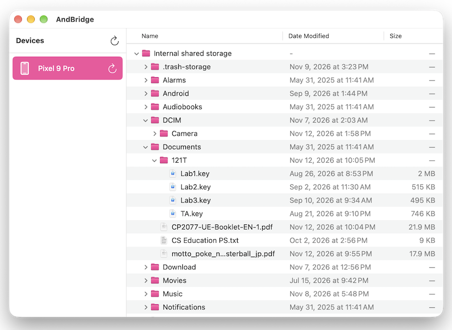

# AndBridge

A file browser for browsing and managing files on Android devices on Mac computers.

Download the latest release from the [Releases page](https://github.com/homeofhx/andbridge/releases/latest).

## Features

- Browse files in the connected Android devices

- Drag and drop files between the Mac computer and the connected Android devices

- Create folders or copy/paste/delete files in the connected Android devices

## How to Use

1. Connect the Android device to the Mac computer with a USB cable.

2. Set the Android device's USB mode to **File Transfer / Android Auto (MTP)**.

3. Select the Android device from the sidebar in AndBridge.

   - Remember to give AndBridge file access permission if prompted.

   - If the Android device isn't listed, click Refresh in the sidebar.

Now you can browse and manage files in the selected Android device.

## Technical Details

**macOS Compatibility:** 10.15 (Catalina) or later

**Frameworks Used:** SwiftUI, AppKit, ImageCaptureCore

**License:** [GNU General Public License v3.0](LICENSE)